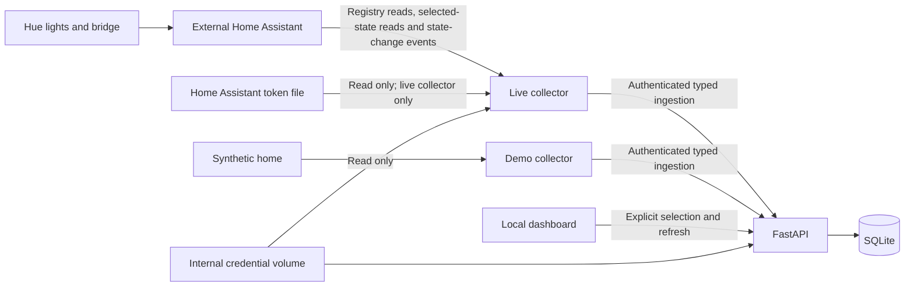

# Home Observer

A local smart-home monitor with explicit device discovery and selection. Run a
hardware-free synthetic demo, or connect an existing Home Assistant instance and
record selected individual Hue lights. There is no AI agent or device control yet.

## Start the demo

Install Docker Engine with Compose on Linux, or Docker Desktop with Compose on
Windows/WSL2 or macOS. From this repository:

```sh
docker compose up --build --wait
```

Open <http://127.0.0.1:8000>. The collector discovers five synthetic entities:
two individual Hue lights, a room aggregate, a non-Hue plug, and an ungrouped
sensor. Only individual lights can be selected. Click **Monitor** to establish a
baseline. Nothing is monitored automatically. After selection, the demo emits a
repeatable sequence of on/off, brightness, color-temperature, XY color,
unavailability and recovery changes, one step per collection pass. The timeline
shows only events recorded after selection. Restarting the collector starts the
sequence again; it does not erase retained history.

Selection takes effect on the next collection pass, normally within 10 seconds.
The old source change date is deliberate. A recent collection can confirm a
state that has not changed for months. A script-shaped device name is also
deliberate; the dashboard displays it as text.

The dashboard refreshes every three seconds. **Refresh discovery** requests a
new catalog on the next collection pass. A newly discovered light stays
unselected until you choose it.

```sh
docker compose restart
# Stop services, keeping selected devices and baselines:
docker compose down
```

SQLite data and the internal service credential persist in named volumes.
`docker compose down --volumes` deletes those volumes. Changing selection never
requires a restart. **Stop monitoring** rejects later observation ingestion.
Previously recorded events stay visible until retention expires.

## Connect Home Assistant and Hue

This setup does not install Home Assistant. First run Home Assistant separately
and pair your Hue Bridge through its [Hue integration](https://www.home-assistant.io/integrations/hue/).
Home Observer connects to Home Assistant, rather than directly to the bridge.

Create a dedicated Home Assistant user with permission to read the required
registries and selected entities, then generate a long-lived access token from
that user's profile. Home Assistant tokens do not provide a per-token read-only
entity scope. Treat the token as a powerful credential. The connector restricts
its own operations to fixed discovery, selected-state reads and a read-only
state-change subscription.

Save the token alone in a local file outside this repository. Do not put it in
`.env`, a URL, a shell command argument, the dashboard, or a Compose environment
variable. On Linux/WSL, restrict the file so container user `10001` can read it:

```sh
# Replace this example path with your token file. These commands contain no token.
sudo chown 10001:10001 /absolute/path/to/ha-token
sudo chmod 600 /absolute/path/to/ha-token
```

Docker Desktop file-sharing permissions may differ. Confirm that the mounted
file is readable by container user `10001` without making it publicly readable.
Set the connection origin and absolute token file path, then start live mode:

```sh
export OBSERVER_HA_URL=https://home-assistant.example.test:8123
export OBSERVER_HA_TOKEN_FILE=/absolute/path/to/ha-token
docker compose -f compose.yaml -f compose.live.yaml up --build --wait
```

Use your actual Home Assistant origin, without credentials, a query string or an
API path. The address above is an example. HTTPS certificate verification stays
on. Install a certificate trusted by the container; invalid certificates fail
collection. HTTP is supported for a trusted local network, but does not encrypt
the token in transit.

Open <http://127.0.0.1:8000>. The header identifies Home Assistant mode. Discovery
lists minimal device/entity metadata exposed by Home Assistant. Only enabled
individual Hue V2 lights with recognized registry metadata can be monitored.
Hue groups, other integrations, disabled entities and unknown metadata remain
unsupported. This classification uses the released Home Assistant
[2026.10.1 individual-light contract](https://github.com/home-assistant/core/blob/2026.10.1/homeassistant/components/hue/v2/light.py)
and [group-light contract](https://github.com/home-assistant/core/blob/2026.10.1/homeassistant/components/hue/v2/group.py).
Changed or legacy metadata is rejected rather than guessed.

Select a light to record its first state. Add more devices to Home Assistant and
click **Refresh discovery** to find them without changing configuration or
restarting. Stable entity registry identity keeps selection and history across
an entity name change. A new registry entry reusing an old entity ID does not
inherit approval.

Live mode uses its own `live-data` SQLite volume. Keep demo and live data separate.
The API rejects a database containing another source. Stop the demo before
starting live mode because both publish the same localhost port. To stop live
mode while retaining data:

```sh
docker compose -f compose.yaml -f compose.live.yaml down
```

Use both Compose files for live start, restart and stop commands. Adding
`--volumes` to the live stop command deletes its named volumes.

## Collection and evidence limits

The collector refreshes discovery and polls selected current states in each
collection pass. Live mode also subscribes to Home Assistant state-change events
while at least one light is selected. The trusted connector discards unselected
events before forwarding them to the API. An empty selection opens no event
subscription. It waits ten seconds between passes by default. Slow requests
can lengthen the interval. Change the interval without storing a secret:

```sh
OBSERVER_RECONCILIATION_SECONDS=30 docker compose up --build --wait
```

For live mode, add `-f compose.yaml -f compose.live.yaml` to that command. Use a
positive interval in seconds. Freshness becomes stale after twice the interval
or a reported collector failure. Authentication, connection and certificate
errors appear as safe status messages. A failed refresh retains the previous
catalog marked stale. A missing or unreadable selected entity remains selected,
with unknown or stale evidence. This does not prove the bulb is disconnected.

Each accepted snapshot records its stable ID, registry identity, current entity
ID, source, state, availability, receipt time and server-owned persistence time.
Source change, update and report timestamps remain separate. Initial baselines
and polling reconciliation snapshots update the current state, but do not create
change entries. Unchanged polling updates collection confirmation. Freshness
means Home Assistant answered recently, not that the bulb itself answered then.

The **Recorded changes** timeline stores observed state, availability, brightness
and color transitions. Each entry includes its evidence ID, source entity and
stable registry identity, old and new values, Home Assistant's `time_fired`,
connector receipt time and API persistence time. Recorded changes use the
[Home Assistant WebSocket `state_changed` subscription](https://developers.home-assistant.io/docs/api/websocket/#subscribe-to-events).
The connector keeps only approved light fields. It drops unrelated attributes,
account identifiers and raw logs. Duplicate delivery creates one event. A late
event remains in history without replacing a newer current state.

Allowed color fields are `color_mode`, `color_temp_kelvin`, `hs_color`, `xy_color`,
`rgb_color`, `rgbw_color` and `rgbww_color`. Brightness uses integers from 0 to
255. Color temperature uses integer kelvin values from 1000 to 10000. Hue/saturation uses
two finite numbers within 0..360 and 0..100; XY uses two finite numbers within
0..1. RGB, RGBW and RGBWW use three, four or five integer channels within 0..255.
Missing fields stay absent, rather than being inferred from another color format.

History refreshes automatically until you load older entries. **Load older
changes** requests another bounded page; **Refresh history** returns to the newest
records. Events from removed selections remain readable until retention expires.
The read-only `GET /api/events` endpoint accepts optional `source_id`, stable
`entity_id`, timezone-aware `start` and `end` timestamps, a `cursor`, and a `limit` from 1 to
100, default 50. It returns `events`, `next_cursor` and `retained_since`. The
retention cutoff is not proof that collection covered that period continuously.

Retention defaults to 30 days. Set a positive number of days on the API service:

```sh
OBSERVER_RETENTION_DAYS=7 docker compose up --build --wait
```

For live mode, add `-f compose.yaml -f compose.live.yaml`. Retention uses the API
persistence time. Requests trigger cleanup of expired historical records.
Active selections and their latest known state stay available in a separate
current-state cache. That cache does not establish recent device availability.
Expired current-state caches for removed selections are deleted too. An empty
timeline means no retained changes were recorded, not that nothing changed.

Home Assistant's [Hue integration](https://www.home-assistant.io/integrations/hue/)
receives pushed updates from Hue V2 bridges and polls V1 bridges. Our event stream
reports what Home Assistant observed. There is no Recorder history import,
historical backfill, automation attribution or cause inference. Earlier events
and changes during a connection interruption may be absent. Polling snapshots
can reconcile the current state but cannot reconstruct those missing changes.
Connection-gap accounting is a later milestone. There is no anomaly detector or
AI investigation yet.

## Architecture



Choose one collector mode. FastAPI is the only SQLite writer. The collector has
no database mount. Discovery describes devices but grants no monitoring approval.
Selection and ingestion use SQLite transactions and a server-owned revision.
Delayed collection cannot bypass a removal or a new selection revision.

## Security boundary

- Only the API publishes a port, on `127.0.0.1`. Both services run as an
  unprivileged user, without Linux capabilities, with read-only filesystems
  except their mounted volumes.
- Only the live collector mounts the Home Assistant token file. The API, SQLite
  and browser never receive it. Whole-home registries stay inside the trusted
  connector until it projects minimal metadata. Raw administrative URLs and
  unused registry identifiers do not enter the catalog or database.
- The API creates an internal service credential in a restricted file. The
  collector mounts its volume read-only. Internal endpoints require it.
  Dashboard mutations require an explicit header and validate Host and Origin.
- Device names render as text under a restrictive Content Security Policy.
  Schema validation limits fields and restricts source identity. Error status
  and logs omit submitted secrets and raw connector responses.
- Home Assistant operations are fixed registry reads, approved entity-state
  reads and a state-change subscription filtered inside the connector. There is no arbitrary HTTP passthrough, shell tool, router
  administration endpoint, service call or device-write operation.
- The demo collector uses an internal Docker network. The live collector also
  has an ordinary bridge network to reach Home Assistant. It has network access
  needed by a trusted credential service. No model can use this service as a
  tool. A future agent needs a separate network boundary and approved evidence
  tools before it can be added.

Do not expose the dashboard publicly. It has no user authentication. This version
makes no model calls, so no data leaves the home for a cloud model. A future cloud
investigation mode must document the evidence it sends before enabling it.
Deco and additional vendor adapters require separate review.

## Networking and platform limits

Use an explicit address reachable from the collector container. Container
`localhost` means that container, not the computer running Docker.

- Windows/WSL2: run Compose in the WSL project with Docker Desktop WSL integration
  enabled. Use the dashboard's published localhost address. For Home Assistant
  on the Windows host, Docker Desktop provides `host.docker.internal`; for a
  separate home server, use its reachable LAN address or DNS name. WSL firewall,
  VPN and LAN routing can affect connectivity.
- macOS with Docker Desktop: `host.docker.internal` identifies the host. LAN DNS,
  firewall and VPN rules still apply. Docker Desktop runs containers inside a VM.
- Native Linux Docker Engine: `host.docker.internal` is not supplied automatically.
  Use a reachable LAN address, or configure a host-gateway mapping explicitly.
  Home Assistant must listen on an address reachable from the container network.

These are setup directions, not platform test results. The demo was verified on
WSL2/Linux kernel `6.18.33.2-microsoft-standard-WSL2`, Docker Engine `29.9.0`
`linux/amd64`, and Compose `5.6.0`. Native Windows, macOS and a separate native
Linux deployment have not been tested. Real Hue hardware and a user's Home
Assistant instance have not been tested.

## Development and verification

Python 3.12, `uv`, and Node.js 24 are the development tools. Node checks static
JavaScript syntax; the frontend has no package dependencies or TypeScript.
Python dependencies are pinned in `uv.lock`.

```sh
uv sync --locked
uv run pytest -q
uv run ruff check .
uv run ruff format --check .
node --check web/app.js
```

CI uses hardware-free checks and a Compose demo smoke test. Live connector tests
use synthetic Home Assistant responses, not home credentials. They distinguish
connector behavior from Home Assistant's physical device behavior.

Story 01's local verification recorded 12 passing API tests, Ruff and JavaScript
syntax checks, browser selection/removal and malicious-name rendering, and
Compose startup/restart/smoke checks. One synthetic selection confirmed in 4.6
seconds with ten-second polling. That is not measured Hue latency.

Story 02 passed 41 local tests, including seven independent boundary probes.
Synthetic WebSocket/REST tests verified selected reads, identity changes, failure
recovery, credential sanitization, payload limits and invalid TLS rejection.
An isolated live Compose deployment against a fake Home Assistant passed
startup, selection, collection, outage and recovery checks in 44.31 seconds,
including image build time. This is test duration, not measured Hue latency.
Demo Compose smoke, Ruff, JavaScript syntax and browser DOM checks also passed.
Hosted CI has not run. No Python static typechecker or TypeScript checks are
claimed. Model calls and model cost are zero.

Story 03 passed 55 local tests, including three independent adversarial probes
and a regression check for upgrading existing databases. Demo Compose smoke
passed. Live Compose against a synthetic Home Assistant recorded a subscribed
brightness event and passed outage/recovery checks in 25.842 seconds, including
image build time. Ruff, JavaScript syntax and a headless browser check passed.
The browser displayed attributed events, no injected script nodes and no
horizontal overflow. These checks use synthetic devices. Real Hue validation,
explicit collection-gap records and hosted CI remain unverified or unfinished.

## License

[MIT](LICENSE). This independent project uses original code, public documentation
and synthetic examples. It contains no employer code or home credentials.
