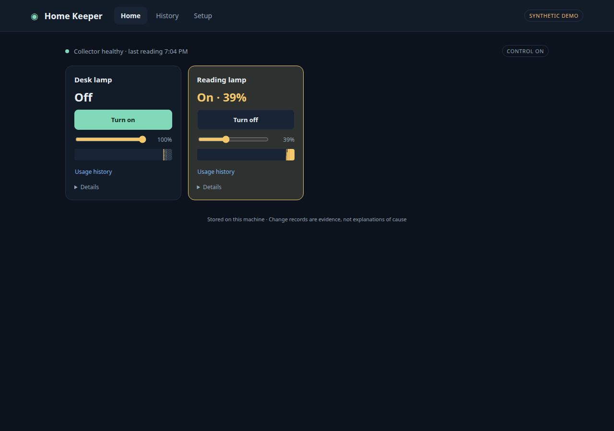
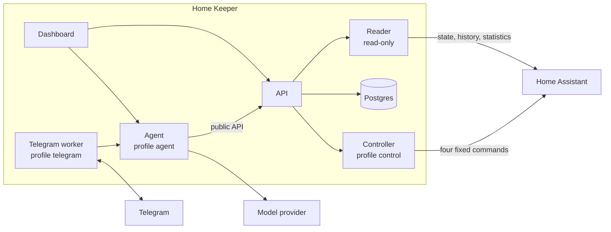

# Home Keeper

[](https://github.com/alitaghub/home-keeper/actions/workflows/ci.yaml)
[](LICENSE)

Home Keeper is a self-hosted agent that looks after your home. It reads your
devices through [Home Assistant](https://www.home-assistant.io/), shows their
current state and their history, and says plainly when it cannot know.



## Features

- **Dashboard.** Current state, a 24-hour strip, usage per day and per hour,
  measurement charts, and a history of every recorded change.
- **Opt-in monitoring.** Home Keeper shows nothing about a device until you
  choose to monitor it.
- **One source of history.** History comes from Home Assistant's recorder.
  Home Keeper keeps no copy and never invents a change.
- **Read-only by default.** Switching lights, plugs and switches needs the
  `control` profile, a separate non-admin Home Assistant user, and a fixed set
  of four commands.
- **Optional agent.** Ask questions in plain words in the dashboard or in
  Telegram. Every device change waits for your approval.
- **Local.** Every port binds to `127.0.0.1`. Nothing leaves your machine
  unless you turn on the agent.

## Quick start

You need Docker with Compose.

### Try the demo

The demo runs a synthetic home. It needs no hardware and no Home Assistant.

```sh
docker compose -f compose.demo.yaml up --build --wait
```

Open <http://localhost:8000/#setup> and click **Monitor** on a lamp.
See [docs/demo.md](docs/demo.md).

### Run it on your home

This starts a bundled Home Assistant and sets it up without clicks.

1. Start the stack:

   ```sh
   docker compose up --build --wait
   ```

2. Print the Home Assistant login:

   ```sh
   docker compose run --rm --no-deps ha-setup login
   ```

3. Open Home Assistant at <http://localhost:8123>, log in, and add your devices
   under **Settings → Devices & services → Add integration**.
4. Open Home Keeper at <http://localhost:8000>. On the **Setup** tab, click
   **Monitor** on a device.

To use a Home Assistant you already run, see
[Use your own Home Assistant](docs/home-assistant.md#use-your-own-home-assistant).

Stop and reset:

```sh
docker compose down            # stop; keep Home Assistant, its history and your selection
docker compose down --volumes  # delete everything
```

## Profiles

Add features with Compose profiles. Each works with the home stack and the demo.

| Profile    | Adds                                                     | Guide                                |
| ---------- | -------------------------------------------------------- | ------------------------------------ |
| `control`  | Switch monitored lights, plugs and switches              | [Device control](docs/control.md)    |
| `agent`    | A chat agent in the dashboard (needs a model provider)   | [Agent](docs/agent.md)               |
| `telegram` | The same agent in private Telegram chats (needs `agent`) | [Telegram](docs/telegram.md)         |

For example:

```sh
docker compose --profile control --profile agent up --build --wait
```

## How it works



- The **reader** holds the Home Assistant token and makes only fixed reads.
- The **API** stores only what is its own: the monitored devices and the
  command log. It reads state and history from Home Assistant on each request.
- The **controller** is the only part that can switch a device. It runs only
  with the `control` profile.
- The **agent** uses the same public API as the dashboard.

[docs/architecture.md](docs/architecture.md) has the full design.

## Documentation

| Guide                                         | Contents                                                       |
| --------------------------------------------- | -------------------------------------------------------------- |
| [Demo](docs/demo.md)                          | The synthetic home and what it shows                           |
| [Home Assistant](docs/home-assistant.md)      | Bundled or own Home Assistant, tokens, history retention       |
| [Devices](docs/devices.md)                    | Device kinds, what can be monitored, and what is kept          |
| [History and usage](docs/history.md)          | Recorded changes, usage numbers, measurements, unknown time    |
| [Device control](docs/control.md)             | The `control` profile, commands, outcomes and refusals         |
| [Agent](docs/agent.md)                        | The agent panel, charts, models, and what leaves your machine  |
| [Telegram](docs/telegram.md)                  | A private family bot for the agent                             |
| [Configuration](docs/configuration.md)        | Every environment variable and Compose file                    |
| [Networking](docs/networking.md)              | Networks, ports, and addresses on Linux, macOS and WSL2        |
| [Security](docs/security.md)                  | Trust boundaries, credentials, and what is not protected       |
| [Architecture](docs/architecture.md)          | Services, data flow, storage and design rules                  |

## Repository layout

| Path                     | Contents                                                                  |
| ------------------------ | ------------------------------------------------------------------------- |
| `apps/keeper`            | Python service: FastAPI API, reader, Home Assistant setup, Postgres store |
| `apps/web`               | Dashboard and agent panel (React, TypeScript) and its Caddy image         |
| `apps/agent`             | Optional agent (Deep Agent served by Aegra) and the Telegram worker       |
| `apps/controller`        | Optional controller: the only code that calls Home Assistant services     |
| `packages/light-command` | Shared Python: the fixed command shapes                                   |
| `packages/settings`      | Shared Python: typed settings from each service's environment             |
| `e2e`                    | Compose smoke tests, a fake Home Assistant, Playwright specs              |
| `docs`                   | User and design documentation                                             |

## Development

[mise](https://mise.jdx.dev/) installs every tool at a pinned version and runs
the tasks.

```sh
mise run setup   # tools, dependencies and the pre-commit hook
mise run check   # lint, types, tests and build, as CI runs them
mise run dev     # demo stack plus the Vite dev server
mise run e2e     # Compose stacks, smoke tests and Playwright
```

Read [CONTRIBUTING.md](CONTRIBUTING.md) before you open a pull request. Coding
agents start at [AGENTS.md](AGENTS.md).

## License

[MIT](LICENSE). This independent project uses original code, public
documentation and synthetic examples. It contains no employer code or home
credentials.
