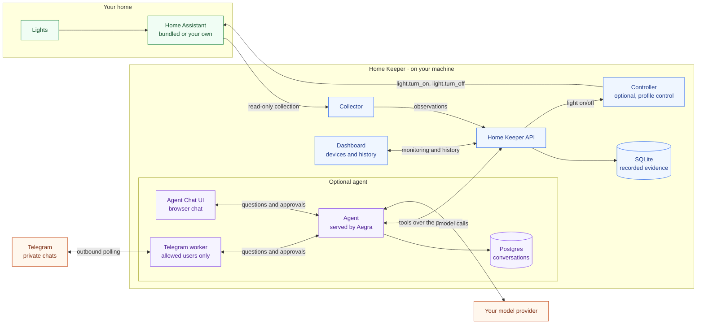

# Home Keeper

[](https://github.com/alitaghub/home-observer/actions/workflows/ci.yaml)
[](LICENSE)

Home Keeper is an agent that looks after your home. Recording is its
foundation: it reads your smart-home devices through
[Home Assistant](https://www.home-assistant.io/), keeps a record of what they
actually do on your machine, and shows honest gaps where collection stopped.

An agent can only act well on a home it can see, so Home Keeper starts with
seeing. By default it does not control devices. With the opt-in `control`
profile, it can switch a light on or off, but only a light it monitors, so every
command leaves evidence.


## How it works



The dashboard works on its own. The optional [agent](docs/agent.md) uses the
same API to answer questions in Agent Chat UI or [Telegram](docs/telegram.md).
It asks for approval before changing which lights are monitored. Neither the
agent nor the collector can control a device; only the optional controller can,
when the API asks it to. The SQLite database remains local.
Questions and tool results go to your model provider; Telegram also receives
your questions and replies.

1. The **collector** discovers devices in Home Assistant and lists them in the
   dashboard.
2. You pick the lights to monitor. Nothing is recorded before you do.
3. The collector takes a baseline snapshot of each selected light, then streams
   its state changes: on/off, brightness, color, availability.
4. The **API** validates every record and stores it in SQLite. If collection
   stops, it records a gap instead of guessing what happened.
5. The **dashboard** shows current state, a timeline of changes, and every gap.

[docs/architecture.md](docs/architecture.md) has the full picture, the selection
flow and the terms the code uses.

## Design principles

- **Read-only by default; control is opt-in.** The collector makes fixed reads
  and one event subscription. It has no code path that changes a device.
  Switching lights needs the `control` profile, which adds a separate controller
  with its own non-admin Home Assistant user. It knows two commands, light on
  (with an optional brightness) and light off, and the API sends them only for
  monitored lights. Without the profile, nothing can switch a light.
- **Opt-in.** Discovery is not permission. Each light is recorded only after you
  select it, and a removal takes effect even if a slow read is still in flight.
- **Evidence, not guesses.** Every event keeps three timestamps: when Home
  Assistant fired it, when the collector received it, and when the API stored it.
  Interruptions show up as gaps. The app never invents a change it did not see.
- **Local.** Everything binds to `127.0.0.1`. The Home Assistant token stays in
  the collector container, and the control token in the controller container. Nothing goes to a cloud service, unless you turn on
  the optional agent: then your questions and its tool results (light names,
  states, usage numbers) go to the model provider you configure. The Home
  Assistant token, the database and the service credential never do.

## Start

You need Docker with Compose. One command starts Home Assistant and Home
Keeper. You do not need Home Assistant installed first:

```sh
docker compose up --build --wait
```

Setup runs without clicks: it creates the Home Assistant owner account and a
token for the collector. Then:

1. Print your Home Assistant login:

   ```sh
   docker compose run --rm --no-deps ha-setup login
   ```

2. Open Home Assistant at <http://127.0.0.1:8123>, log in, and add your devices
   under **Settings → Devices & services → Add integration**. Home Assistant owns
   every device connection. Pairing a Hue Bridge needs one press of its button.
3. Open the dashboard at <http://127.0.0.1:8000>, click **Refresh discovery**,
   then **Monitor** on a lamp.

If port 8000 or 8123 is taken, set `HOME_KEEPER_PORT` or `HA_PORT`, for example
`HOME_KEEPER_PORT=18000 HA_PORT=18123 docker compose up --build --wait`.

`docker compose down` stops everything and keeps Home Assistant, the token and
your history in Docker volumes. Later starts validate the saved token directly
instead of repeating onboarding. `docker compose down --volumes` deletes all of it.
[docs/home-assistant.md](docs/home-assistant.md) covers the details, limits,
and how to use a Home Assistant you already run.

## Try the demo

The demo runs a synthetic home: no hardware and no Home Assistant needed.

```sh
docker compose -f compose.demo.yaml up --build --wait
```

Open <http://127.0.0.1:8000> and click **Monitor** on a lamp. Changes appear in
**Recorded changes** within a few seconds. Stop the home stack first; both use
port 8000. [docs/demo.md](docs/demo.md) explains what the demo shows.

## Switch lights

Add the `control` profile to let the API switch monitored lights:

```sh
docker compose --profile control up --build --wait
```

The demo works too: add `--profile control` to its command. A command returns
what Home Keeper then observed: the change, no change within 5 seconds, a
refusal from Home Assistant, or an unreachable controller. Every command is
recorded. [docs/control.md](docs/control.md) covers the API, the refusals and the
limits.

## Chat with the agent

An optional agent answers questions about your lights in plain words: how long
a lamp was on this week, at which hours, and whether collection was healthy.
It uses only the recorded evidence, says how much time is unknown, and cannot
control devices. Put your model settings in `.env` (see
[.env.example](.env.example)), then:

```sh
docker compose --profile agent up --build --wait
```

Open the chat at <http://127.0.0.1:3000>. The demo works too: add
`--profile agent` to its command. [docs/agent.md](docs/agent.md) covers models,
ports and limits.

## Telegram

You can also talk to the agent privately from Telegram. Set `TELEGRAM_BOT_TOKEN`
and comma-separated `TELEGRAM_ALLOWED_USER_IDS` in `.env`, alongside the agent's
model settings, then:

```sh
docker compose --profile agent --profile telegram up --build --wait
```

For the demo, add `-f compose.demo.yaml` after `docker compose`. Each allowed
family member gets their own saved conversation. Monitoring changes need
Approve/Reject buttons; `/new` starts fresh. The bot uses one sequential worker
and exposes no port. [docs/telegram.md](docs/telegram.md) covers bot creation,
user IDs, setup, limits, and what goes through Telegram.

## Documentation

| Guide                                            | Read it to                                                         |
| ------------------------------------------------ | ------------------------------------------------------------------ |
| [Architecture](docs/architecture.md)             | Understand the parts, the data flow, and the domain terms          |
| [Demo](docs/demo.md)                             | See what the synthetic home does and how to reset it               |
| [Home Assistant and Hue](docs/home-assistant.md) | Run the bundled Home Assistant or your own, and check a real light |
| [Collection and gaps](docs/collection.md)        | Learn what each record proves, how gaps work, and retention        |
| [Light control](docs/control.md)                 | Turn on the `control` profile and switch monitored lights          |
| [Networking](docs/networking.md)                 | Pick an address the collector can reach on WSL2, macOS or Linux    |
| [Agent](docs/agent.md)                           | Chat with the agent, pick a model, and know what it sends out      |
| [Telegram](docs/telegram.md)                   | Talk to the agent through a private family bot                     |
| [Security](docs/security.md)                     | Understand the trust boundaries around the token, API and browser  |

## Repository layout

| Path            | What lives there                                                   |
| --------------- | ------------------------------------------------------------------ |
| `apps/keeper`   | Python service: FastAPI API, collectors, Home Assistant setup, SQLite store, tests |
| `apps/web`      | Dashboard: React and TypeScript, API types generated from OpenAPI  |
| `apps/agent`    | Optional agent: Deep Agent served by Aegra, tools over the public API |
| `apps/controller` | Optional light controller: the only code that calls Home Assistant services |
| `apps/chat`     | Image recipe for the unmodified Agent Chat UI                      |
| `packages/light-command` | Shared Python code: the fixed light command shapes |
| `e2e`           | Compose smoke tests, a fake Home Assistant, Playwright specs       |
| `docs`          | User and design docs                                               |

## Develop

[mise](https://mise.jdx.dev/) installs every tool at a pinned version and runs
the tasks.

```sh
mise run setup      # tools, dependencies, and the pre-commit hook
mise run check      # lint, types, tests, build: what CI runs
mise run dev        # demo stack plus the Vite dev server
mise run e2e        # demo, own-HA, bundled-HA, agent and control stacks, smoke tests, Playwright
```

Read [CONTRIBUTING.md](CONTRIBUTING.md) before you open a pull request. Coding
agents start at [AGENTS.md](AGENTS.md).

## License

[MIT](LICENSE). This independent project uses original code, public documentation
and synthetic examples. It contains no employer code or home credentials.
