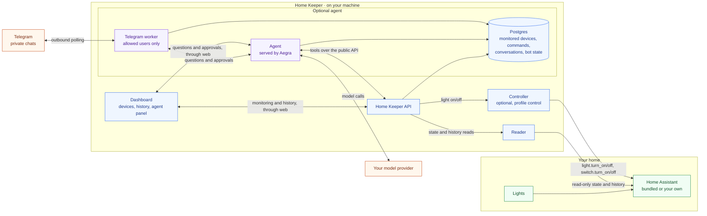

# Home Keeper

[](https://github.com/alitaghub/home-keeper/actions/workflows/ci.yaml)
[](LICENSE)

Home Keeper is an agent that looks after your home. Seeing is its foundation:
it reads your smart-home devices through
[Home Assistant](https://www.home-assistant.io/), shows what they report now and
what they did, from Home Assistant's own history, and says plainly when it
cannot know.

An agent can only act well on a home it can see, so Home Keeper starts with
seeing. By default it does not control devices. With the opt-in `control`
profile, it can switch a light, plug or switch on or off, but only one it
monitors, so every command leaves evidence.


## How it works



The dashboard works on its own. The optional [agent](docs/agent.md) uses the
same API to answer questions in the dashboard's agent panel or in
[Telegram](docs/telegram.md).
It asks for approval before changing which devices are monitored, and before it
switches a light, plug or switch with the `control` profile. Neither the agent nor the reader
talks to Home Assistant to control a device; only the optional controller does,
when the API asks it to. The Postgres database remains local.
Questions and tool results go to your model provider; Telegram also receives
your questions and replies.

1. The **reader** lists the devices in Home Assistant, and the dashboard shows
   them.
2. You pick the devices to monitor: lights, plugs and switches, and any other
   device Home Assistant registers, such as a thermostat or a cover. Home Keeper
   shows nothing about a device before you do.
3. When you open a tab, the **API** asks the reader for what it needs: the state
   Home Assistant reports now, or the history Home Assistant's recorder keeps.
   History covers on/off and availability, plus brightness and color for a light.
   For any other device it covers the state, in Home Assistant's own words.
   How far back it goes depends on Home Assistant's
   [recorder settings](docs/home-assistant.md#history-retention).
4. The API stores only what is its own in Postgres: which devices you monitor and
   the commands it sent. If Home Assistant cannot be reached, every tab says so
   and states show as unknown.
5. The **dashboard** has three tabs. **Home** shows each monitored light under
   **Lights** and switches it, then each monitored plug or switch under **Plugs
   and switches**, then every other device under **Other**, with its state in
   Home Assistant's words and when it last changed. Other devices cannot be
   switched and have no usage.
   A card's status badge is warm when the device is on, grey when it is off, and
   dashed when its state is unknown. Each card draws its last 24 hours as a
   strip: on, as high as the light's brightness, and off. Time Home Assistant reported the device unavailable is
   hatched; time it has no history for stays blank. **Usage history** on a card
   opens that device's last 24 hours, 7 days or 30 days, with its totals and its
   on-time per day and per hour of day.
   **History** lists commands and changes in plain words, with the details behind
   **Details**. **Setup** chooses which devices to monitor, with a search by
   name, for homes of up to 5000 entities.
   The dashboard follows your system's light or dark setting.

[docs/architecture.md](docs/architecture.md) has the full picture, the selection
flow and the terms the code uses.

## Design principles

- **Read-only by default; control is opt-in.** The reader makes a fixed set of
  reads. It has no code path that changes a device.
  Switching devices needs the `control` profile, which adds a separate controller
  with its own non-admin Home Assistant user. It knows four commands, light on
  (with an optional brightness), light off, switch on and switch off, and the API
  sends them only for monitored devices. Without the profile, nothing can switch
  a device.
- **Opt-in.** Discovery is not permission. Monitoring is the only filter: History,
  usage and the agent cover only the devices you monitor now. Monitoring a device
  again shows all the history Home Assistant has for it.
- **One source of history.** Home Assistant's recorder already keeps device
  history, so Home Keeper reads it instead of copying it. Time Home Assistant has
  no history for, or reported a device unavailable, counts as unknown. The app
  never invents a change Home Assistant did not record.
- **Local.** Everything binds to `127.0.0.1`. The Home Assistant token stays in
  the reader container, and the control token in the controller container. Nothing goes to a cloud service, unless you turn on
  the optional agent: then your questions and its tool results (light names,
  states, usage numbers) go to the model provider you configure. The Home
  Assistant token, the database and the service credential never do.

## Start

You need Docker with Compose. One command starts Home Assistant and Home
Keeper. You do not need Home Assistant installed first:

```sh
docker compose up --build --wait
```

Setup runs without clicks: it creates the Home Assistant owner account and a
token for the reader. Then:

1. Print your Home Assistant login:

   ```sh
   docker compose run --rm --no-deps ha-setup login
   ```

2. Open Home Assistant at <http://127.0.0.1:8123>, log in, and add your devices
   under **Settings → Devices & services → Add integration**. Home Assistant owns
   every device connection. Home Keeper can monitor any single device that Home
   Assistant shows, from any brand: lights, smart plugs and switches, and any
   other device, such as a thermostat. It does not monitor groups, rooms, people
   or settings. [Home Assistant](docs/home-assistant.md#discover-and-select-devices)
   lists the rules.
   Pairing a Hue Bridge, for example, needs one press of its button.
3. Open the dashboard at <http://localhost:8000>. On the **Setup** tab, click
   **Monitor** on a lamp.

If port 8000 or 8123 is taken, set `HOME_KEEPER_PORT` or `HA_PORT`, for example
`HOME_KEEPER_PORT=18000 HA_PORT=18123 docker compose up --build --wait`.

`docker compose down` stops everything and keeps Home Assistant with its
history, the token and your monitored devices in Docker volumes. Later starts validate the saved token directly
instead of repeating onboarding. `docker compose down --volumes` deletes all of it.
[docs/home-assistant.md](docs/home-assistant.md) covers the details, limits,
and how to use a Home Assistant you already run.

Home Keeper keeps everything of its own in one Postgres. The API, the agent and
the Telegram bot each get their own database and login in it, with a password
that only that service can read. Upgrading from a release that used SQLite: Home
Keeper does not import the old files. Select your devices again once. Chat
threads and the Telegram bot's state also start empty. History still comes from
Home Assistant. The old `data`, `agent-postgres` and `telegram-state` volumes are
no longer used; delete them with `docker volume rm` when you no longer want them.

## Try the demo

The demo runs a synthetic home: no hardware and no Home Assistant needed.

```sh
docker compose -f compose.demo.yaml up --build --wait
```

Open <http://localhost:8000#setup> and click **Monitor** on a lamp. The lamp
appears on the **Home** tab, and a day of its synthetic history appears on the
**History** tab at once. Stop the home stack first; both use
port 8000. [docs/demo.md](docs/demo.md) explains what the demo shows.

## Switch lights

Add the `control` profile to let the API switch monitored lights:

```sh
docker compose --profile control up --build --wait
```

The demo works too: add `--profile control` to its command. The dashboard then
shows `CONTROL ON`, and each monitored light with a known on or off state gets a
**Turn on** or **Turn off** button and a brightness slider. Each monitored plug
or switch gets the button only. One click sends the
command. The dashboard
then shows what Home Keeper observed: the change, no change within 5 seconds, a
refusal from Home Assistant, or an unreachable controller. Every command is
recorded, and the dashboard lists recent commands with their sender and outcome
on the **History** tab. [docs/control.md](docs/control.md) covers the
dashboard, the API, the refusals and the limits.

## Chat with the agent

An optional agent answers questions about your lights in plain words: how long
a lamp was on this week, at which hours, and whether Home Assistant can be
reached. It uses only Home Assistant's history and says how much time is unknown. With the
`control` profile, it can also switch a monitored light, plug or switch after you approve it. Put your model settings in `.env` (see
[.env.example](.env.example)), then:

```sh
docker compose --profile agent up --build --wait
```

Open the dashboard at <http://localhost:8000> and select **Ask** in the header.
The agent panel opens beside the current tab: answers stream in, you approve or
reject each proposed device change there, and **Recent chats** brings back
earlier conversations. The demo works too: add `--profile agent` to its command.
[docs/agent.md](docs/agent.md) covers models, ports and limits.

## Telegram

You can also talk to the agent privately from Telegram. Set `TELEGRAM_BOT_TOKEN`
and comma-separated `TELEGRAM_ALLOWED_USER_IDS` in `.env`, alongside the agent's
model settings, then:

```sh
docker compose --profile agent --profile telegram up --build --wait
```

For the demo, add `-f compose.demo.yaml` after `docker compose`. Each allowed
family member gets their own saved conversation. Monitoring and light changes
need Approve/Reject buttons, and only people on the control list can approve
light changes; `/new` starts fresh. The bot uses one sequential worker
and exposes no port. [docs/telegram.md](docs/telegram.md) covers bot creation,
user IDs, setup, limits, and what goes through Telegram.

## Documentation

| Guide                                     | Read it to                                                         |
| ----------------------------------------- | ------------------------------------------------------------------ |
| [Architecture](docs/architecture.md)      | Understand the parts, the data flow, and the domain terms          |
| [Demo](docs/demo.md)                      | See what the synthetic home does and how to reset it               |
| [Home Assistant](docs/home-assistant.md)  | Run the bundled Home Assistant or your own, and check a real light |
| [History and usage](docs/collection.md)   | Learn where history comes from, what unknown time means, and retention |
| [Light control](docs/control.md)          | Turn on the `control` profile and switch monitored lights and plugs |
| [Networking](docs/networking.md)                 | Pick an address the reader can reach on WSL2, macOS or Linux       |
| [Agent](docs/agent.md)                           | Chat with the agent, pick a model, and know what it sends out      |
| [Telegram](docs/telegram.md)                   | Talk to the agent through a private family bot                     |
| [Security](docs/security.md)                     | Understand the trust boundaries around the token, API and browser  |

## Repository layout

| Path            | What lives there                                                   |
| --------------- | ------------------------------------------------------------------ |
| `apps/keeper`   | Python service: FastAPI API, reader, Home Assistant setup, Postgres store, tests |
| `apps/web`      | Dashboard and agent panel: React and TypeScript, API types generated from OpenAPI, and the Caddy image that serves it |
| `apps/agent`    | Optional agent: Deep Agent served by Aegra, tools over the public API |
| `apps/controller` | Optional light controller: the only code that calls Home Assistant services |
| `packages/light-command` | Shared Python code: the fixed light command shapes |
| `packages/settings` | Shared Python code: reads each service's environment into typed settings |
| `e2e`           | Compose smoke tests, a fake Home Assistant, Playwright specs       |
| `docs`          | User and design docs                                               |

## Develop

[mise](https://mise.jdx.dev/) installs every tool at a pinned version and runs
the tasks.

```sh
mise run setup      # tools, dependencies, and the pre-commit hook
mise run check      # lint, types, tests, build: what CI runs
mise run dev        # demo stack plus the Vite dev server
mise run e2e        # demo, own-HA, bundled-HA, agent and control stacks, smoke tests, Playwright
```

Read [CONTRIBUTING.md](CONTRIBUTING.md) before you open a pull request. Coding
agents start at [AGENTS.md](AGENTS.md).

## License

[MIT](LICENSE). This independent project uses original code, public documentation
and synthetic examples. It contains no employer code or home credentials.
