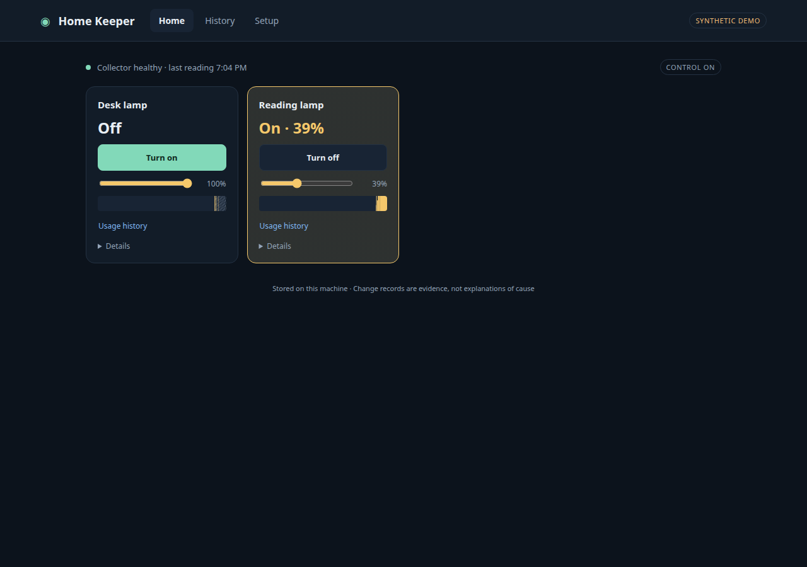
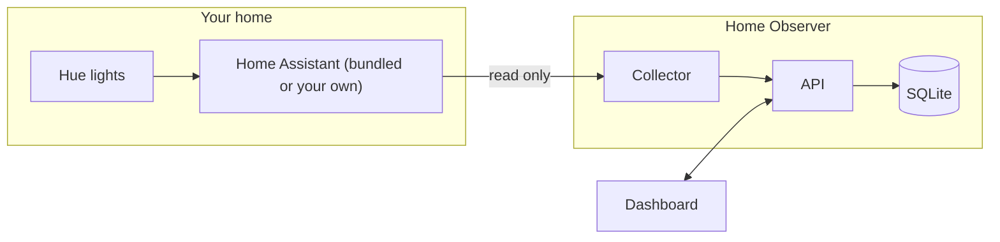

# Home Observer

[](https://github.com/alitaghub/home-observer/actions/workflows/ci.yaml)
[](LICENSE)

Home Observer records what your smart-home devices actually do. It reads them
through [Home Assistant](https://www.home-assistant.io/), keeps the evidence on
your machine, and never sends a command to a device.

The long-term goal is an agent that understands your home and runs it for you.
An agent can only act well on a home it can see, so this project starts with
seeing: a trustworthy, typed record of state changes, with honest gaps where
collection stopped.



## How it works



1. The **collector** discovers devices in Home Assistant and lists them in the
   dashboard.
2. You pick the lights to monitor. Nothing is recorded before you do.
3. The collector takes a baseline snapshot of each selected light, then streams
   its state changes: on/off, brightness, color, availability.
4. The **API** validates every record and stores it in SQLite. If collection
   stops, it records a gap instead of guessing what happened.
5. The **dashboard** shows current state, a timeline of changes, and every gap.

[docs/architecture.md](docs/architecture.md) has the full picture, the selection
flow and the terms the code uses.

## Design principles

- **Read-only.** The connector makes fixed reads and one event subscription. It
  has no code path that changes a device.
- **Opt-in.** Discovery is not permission. Each light is recorded only after you
  select it, and a removal takes effect even if a slow read is still in flight.
- **Evidence, not guesses.** Every event keeps three timestamps: when Home
  Assistant fired it, when the collector received it, and when the API stored it.
  Interruptions show up as gaps. The app never invents a change it did not see.
- **Local.** Everything binds to `127.0.0.1`. The Home Assistant token stays in
  the collector container. Nothing goes to a cloud service.

## Start

You need Docker with Compose. One command starts Home Assistant and Home
Observer. You do not need Home Assistant installed first:

```sh
docker compose up --build --wait
```

Setup runs without clicks: it creates the Home Assistant owner account and a
token for the collector. Then:

1. Print your Home Assistant login:

   ```sh
   docker compose run --rm --no-deps ha-setup login
   ```

2. Open Home Assistant at <http://127.0.0.1:8123>, log in, and add your devices
   under **Settings → Devices & services → Add integration**. Home Assistant owns
   every device connection. Pairing a Hue Bridge needs one press of its button.
3. Open the dashboard at <http://127.0.0.1:8000>, click **Refresh discovery**,
   then **Monitor** on a lamp.

If port 8000 or 8123 is taken, set `OBSERVER_PORT` or `HA_PORT`, for example
`OBSERVER_PORT=18000 HA_PORT=18123 docker compose up --build --wait`.

`docker compose down` stops everything and keeps Home Assistant, the token and
your history in Docker volumes. `docker compose down --volumes` deletes all of
it. [docs/home-assistant.md](docs/home-assistant.md) covers the details, limits,
and how to use a Home Assistant you already run.

## Try the demo

The demo runs a synthetic home: no hardware and no Home Assistant needed.

```sh
docker compose -f compose.demo.yaml up --build --wait
```

Open <http://127.0.0.1:8000> and click **Monitor** on a lamp. Changes appear in
**Recorded changes** within a few seconds. Stop the home stack first; both use
port 8000. [docs/demo.md](docs/demo.md) explains what the demo shows.

## Documentation

| Guide                                            | Read it to                                                         |
| ------------------------------------------------ | ------------------------------------------------------------------ |
| [Architecture](docs/architecture.md)             | Understand the parts, the data flow, and the domain terms          |
| [Demo](docs/demo.md)                             | See what the synthetic home does and how to reset it               |
| [Home Assistant and Hue](docs/home-assistant.md) | Run the bundled Home Assistant or your own, and check a real light |
| [Collection and gaps](docs/collection.md)        | Learn what each record proves, how gaps work, and retention        |
| [Networking](docs/networking.md)                 | Pick an address the collector can reach on WSL2, macOS or Linux    |
| [Security](docs/security.md)                     | Understand the trust boundaries around the token, API and browser  |

## Repository layout

| Path            | What lives there                                                   |
| --------------- | ------------------------------------------------------------------ |
| `apps/observer` | Python service: FastAPI API, collectors, Home Assistant setup, SQLite store, tests |
| `apps/web`      | Dashboard: React and TypeScript, API types generated from OpenAPI  |
| `e2e`           | Compose smoke tests, a fake Home Assistant, Playwright specs       |
| `docs`          | User and design docs                                               |

## Develop

[mise](https://mise.jdx.dev/) installs every tool at a pinned version and runs
the tasks.

```sh
mise run setup      # tools, dependencies, and the pre-commit hook
mise run check      # lint, types, tests, build: what CI runs
mise run dev        # demo stack plus the Vite dev server
mise run e2e        # demo, own-HA and bundled-HA stacks, smoke tests, Playwright
```

VS Code users get workspace settings and recommended extensions; see
[CONTRIBUTING.md](CONTRIBUTING.md#vs-code).

Read [CONTRIBUTING.md](CONTRIBUTING.md) before you open a pull request. Coding
agents start at [AGENTS.md](AGENTS.md).

## License

[MIT](LICENSE). This independent project uses original code, public documentation
and synthetic examples. It contains no employer code or home credentials.
