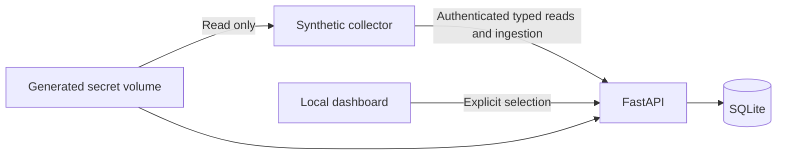

# Home Observer

A local smart-home monitor, starting with explicit device discovery and selection.
This first milestone runs a synthetic home. It has no agent, model calls, device
controls or live Home Assistant connection yet.

## Start the demo

Install Docker Engine with Compose on Linux, or Docker Desktop on Windows/WSL2
or macOS. From this repository:

```sh
docker compose up --build --wait
```

Open <http://127.0.0.1:8000>. The collector discovers five synthetic entities:
two individual Hue lights, a room aggregate, a non-Hue plug, and an ungrouped
sensor. Only individual lights can be selected. Click **Monitor** to establish a
baseline. Nothing is monitored automatically.

Selection takes effect on the next collection pass, normally within 10 seconds.
The old source change date is deliberate: collection can be fresh even when a
light has not changed for months. A script-shaped device name is also deliberate;
the dashboard displays it as text.

The dashboard refreshes its view every three seconds. **Refresh discovery** loads
the latest catalog collected by the synthetic connector. In this milestone that
catalog is fixed, and the connector refreshes it on every collection pass.

```sh
docker compose restart
# Stop services, keeping selected devices and baselines:
docker compose down
```

SQLite data and the generated internal credential persist in separate named
volumes. `docker compose down --volumes` deletes both. Changing selection never
requires a restart. **Stop monitoring** removes the light from current views and
rejects later observation ingestion. Previously recorded baselines stay stored.

To change collection timing without storing a secret:

```sh
OBSERVER_RECONCILIATION_SECONDS=30 docker compose up --build --wait
```

Use a positive interval in seconds. Freshness becomes stale after twice that
interval or when the collector reports failure. Missing observations are pending,
not evidence of an unavailable bulb.

## What is recorded

Each baseline has a stable ID, entity ID, synthetic source, state, availability,
receipt time, and server-owned persistence time. Source change, update and report
timestamps remain separate. The latest confirmed collection time updates after
unchanged reconciliation without duplicating baseline history.

This milestone does not implement an event timeline, historical import, retention
cleanup, investigations, or recovery-gap accounting. Baselines currently remain
until the data volume is removed. Do not use this milestone to collect real home
history. The planned history milestone adds configurable retention.

## Architecture



FastAPI is the only SQLite writer. The collector has no database mount. Catalog
refresh describes devices but does not grant or revoke user approval. A selected
entity missing from discovery stays selected, displays unknown or stale evidence,
and cannot receive new observations until supported discovery returns. The user
can remove it explicitly.

Selection changes and observation acceptance use SQLite transactions and a
server-owned revision. A delayed collector snapshot cannot bypass a removal or a
new selection revision. Unsupported and unknown IDs cannot be selected or ingested.

## Security boundary

- Only the API publishes a port, explicitly on `127.0.0.1`. The collector has no
  published port. Both services run without Linux capabilities, as an unprivileged
  user, with a read-only filesystem except their mounted volumes.
- The API generates an internal service credential in a restricted file. The
  collector mounts that secret volume read-only. The dashboard never receives it.
  This is a service-ingestion credential, not a Home Assistant token.
- Internal endpoints require that credential. Dashboard mutations require an
  explicit header, validate Host and Origin, and deny cross-site requests.
- Device names render with `textContent`, under a restrictive Content Security
  Policy. Schema validation caps fields and accepts only the synthetic source.
  Validation errors and collector failures never echo submitted values or secrets.
- The collector can post catalog, observations and health to a fixed internal API.
  There are no shell tools, arbitrary HTTP tools, vendor credentials, router
  administration endpoints or device-write operations.
- The collector attaches only to an internal collection network. The API also
  attaches to an ordinary bridge network so Docker can publish its localhost
  dashboard port. This separates the collector from direct internet routing,
  but does not prove that every host service is unreachable. There is no agent
  in this milestone. Its later network boundary requires separate tests.

Do not expose this service publicly. It has no user authentication. No data leaves
the home for a cloud model because this milestone makes no model calls.

## Development and checks

Python 3.12, `uv`, and Node.js 24 are the development tools. Node only checks the
static JavaScript syntax; there are no frontend package dependencies or TypeScript
claims. Python dependencies are pinned in `uv.lock`.

```sh
uv sync --locked
uv run pytest -q
uv run ruff check .
uv run ruff format --check .
node --check web/app.js
```

CI runs these hardware-free checks and starts the Compose demo. Tests exercise
real temporary SQLite files and API requests. They cover explicit approval,
selection persistence, rejected delayed ingestion, freshness, malformed data,
credential checks, and browser request boundaries. Browser and actual deployment
results are recorded separately in the local build report; the plan alone does
not prove a check passed.

## Verification

The following checks passed locally on the WSL2/Linux runtime described below.
Hosted CI has not run because this change has not been pushed.

| Check | Observed result |
| --- | --- |
| API integration tests | 12 passed, including selection, timestamp ordering, access restrictions and failure/recovery |
| Python lint and formatting | Ruff passed |
| Frontend | JavaScript syntax passed; browser navigation, selection/removal and literal malicious-name rendering passed |
| Deployment | Compose startup, restart and positive smoke passed; smoke failed as expected with the collector stopped |
| Collection delay | One synthetic selection took 4.6 seconds to confirm with 10-second polling; this is not measured Hue latency |
| Model usage | Zero model calls and zero model cost |

There is one upstream TestClient deprecation warning. No Python static typechecker
or TypeScript checks ran. Browser screenshot capture failed, so visual screenshot
review is not claimed. Live Hue and Home Assistant behavior were not tested.

## Platform and live-mode limits

Compose uses an explicit URL, so it does not depend on local `.local` name
resolution. On Windows, run Compose in the WSL2 project directory with Docker
Desktop WSL integration enabled and use the published localhost URL. Container
`localhost` refers to that container, not the Windows, Linux or macOS host.

The demo was verified on WSL2/Linux with kernel
`6.18.33.2-microsoft-standard-WSL2`, Docker Engine `29.9.0` on `linux/amd64`,
and Compose `5.6.0`. Native Windows, macOS, and a separate native Linux deployment
have not been tested. No direct Hue discovery or live Home Assistant networking
was implemented or verified in this milestone.

Live mode will connect to an existing Home Assistant instance; setup will not
install Home Assistant. Discovery will show entities exposed by Home Assistant,
then explicit selection will approve supported individual Hue lights. Vendor
adapters and Deco support remain later work.

## License

[MIT](LICENSE). This is an independent project with original code and synthetic
examples. It contains no employer code or home credentials.
