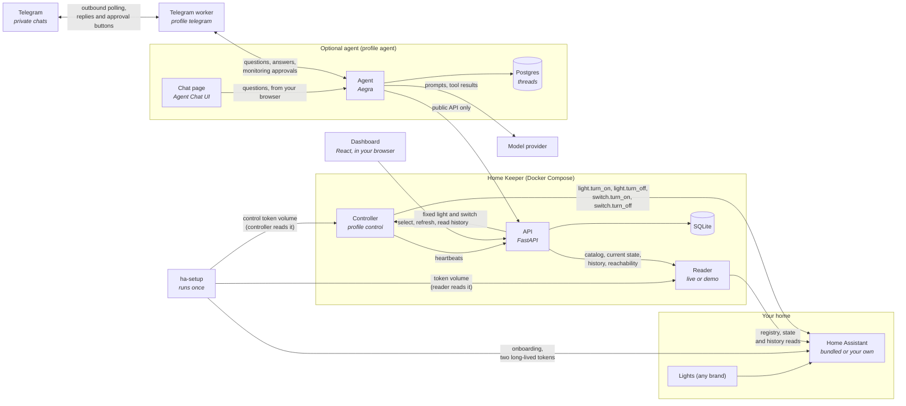
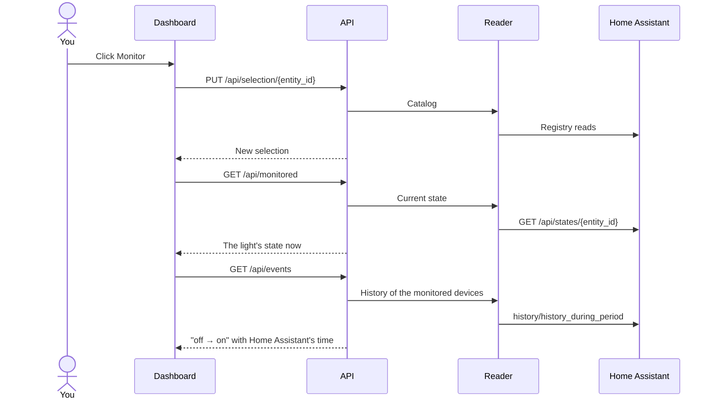

# Architecture

Home Keeper has three running parts: a reader that reads Home Assistant when
asked, an API that decides what to show, and a dashboard that shows it. Device
history stays in Home Assistant's recorder; Home Keeper keeps no copy of it.
They run as two containers from one image. The default stack adds a bundled Home
Assistant and a one-shot `ha-setup` container that onboards it and stores the
reader's and the controller's tokens.
The optional `control` profile adds a controller, from its own image, that
switches monitored lights, plugs and switches for the API; [control.md](control.md) covers it.
The optional `agent` profile adds a chat agent, its chat page and a Postgres for
its threads; [agent.md](agent.md) covers it.
The separate `telegram` profile adds a polling worker that connects private
Telegram chats to the same agent; [telegram.md](telegram.md) covers setup.

| Part      | Code                                   | Job                                                                                         |
| --------- | -------------------------------------- | ------------------------------------------------------------------------------------------- |
| Reader    | `reader_service.py`, `home_assistant.py` | Holds the Home Assistant token. Answers the API's reads of the catalog, current state, history and reachability on request. Keeps no state; caches the catalog for up to 10 seconds. The API reaches it through `reader.py`. |
| Setup     | `ha_setup.py`                          | Onboards the bundled Home Assistant once and stores the reader's token. Creates the non-admin control user and its token. Checks both tokens on later runs. |
| Demo      | `demo.py`, `reader_service.py`         | The reader's synthetic home. Same reader routes, no hardware, a day of synthetic history from the start. Applies demo light commands. |
| API       | `api.py`, `models.py`, `control.py`    | Validates requests and answers them from the reader and the store. Routes selection to Monitoring and commands to Commands. |
| History   | `changes.py`, `usage.py`               | Turns Home Assistant's history rows into the changes History lists and the usage numbers, with unknown time named. |
| Monitoring | `monitoring.py`                       | Owns the selection, checks a new selection against Home Assistant's catalog, and answers each monitored device's current state from the reader. |
| Commands  | `commands.py`                          | Checks, forwards and records commands to monitored lights, plugs and switches, then reads the device's state every 0.5 s for up to 5 s to confirm the outcome. |
| Controller | `apps/controller`                     | Optional (profile `control`). Sends the four fixed calls (`light.turn_on`, `light.turn_off`, `switch.turn_on`, `switch.turn_off`) for monitored lights, plugs and switches to Home Assistant with its own token, or to the demo reader. Publishes no port. |
| Store     | `store.py`                             | SQLite: the selection, the command log and a few metadata values. Replaces a database an earlier release wrote. Command retention. |
| Dashboard | `apps/web`                             | Discovery, selection, current state, the change timeline and the command log.               |
| Agent     | `apps/agent`                           | Optional. Answers questions with tools over the public API. Never reads the database or Home Assistant. |
| Chat      | `apps/chat`                            | Optional. Builds the unmodified Agent Chat UI. Your browser talks to the agent directly.    |
| Telegram  | `apps/agent/src/home_keeper_agent/telegram.py` | Optional. Polls private messages from allowed users and forwards questions and approvals to the agent. Publishes no port. |

Python code lives in `apps/keeper/src/home_keeper`.

## Rules the layout enforces

- **The API is the only writer.** Only the API mounts the database. The reader
  and the controller answer internal requests that need a service credential the
  API creates at startup.
- **Home Keeper stores only what is its own.** The database holds the selection,
  the command log and a few metadata values. Device state and history are read
  from Home Assistant on each request, so the dashboard never shows a stale copy.
  When Home Assistant cannot be reached, states show as unknown and every tab
  shows a banner.
- **Nothing is monitored until you select it.** Discovery lists devices. It does
  not approve them. Monitoring is the only filter: History, usage and the agent
  cover the devices monitored now, with all the history Home Assistant has for
  them.
- **The reader is read-only toward the home.** The connector makes fixed
  registry reads, one state read for each new light or switch candidate at
  discovery to detect groups, state reads of the devices the API asks for,
  `history/history_during_period` for their history, and `GET /api/` to check
  reachability. It has no service calls, no event subscription, no device writes
  and no database mount. The keeper image
  contains no controller code. The API never joins the `home-assistant` network.
- **Control is opt-in and narrow.** Only the controller calls Home Assistant
  services, and only `light.turn_on` (with an optional brightness percent) and
  `light.turn_off` on `light.*` entities, and `switch.turn_on` and
  `switch.turn_off` on `switch.*` entities. It has no passthrough. It runs only
  with the `control` profile, and the API reports control `on` only while the
  controller's heartbeat is fresh.
- **Every command leaves evidence.** The API refuses a command for a light that
  is not monitored, has no known state, is unavailable or is already in that
  state. It records every command it forwards, with the outcome it observed.
- **Unknown, not guessed.** Time Home Assistant has no history for, and time it
  reported a device unavailable, counts as unknown. The API never invents a change
  Home Assistant did not record.

## Selecting a light

The dashboard polls every 3 seconds, and each poll reaches Home Assistant through
the reader.

## Words used in the code

| Term        | Meaning                                                                                       |
| ----------- | --------------------------------------------------------------------------------------------- |
| Source      | Where data comes from: `demo` or `home_assistant`. One database holds one source.             |
| Catalog     | The devices and entities the reader lists from Home Assistant, with whether each one can be monitored. |
| Device kind | What a device is, from its Home Assistant domain: `light` or `switch` (plugs too).           |
| Selection   | The lights, plugs and switches you chose to monitor. The only filter for history, usage and the agent. |
| Reader      | The service that reads Home Assistant for the API: catalog, current state, history and reachability. |
| History     | A device's past states as Home Assistant's recorder keeps them. Read on demand, never copied. |
| Change      | Two consecutive history rows of a monitored device that differ in state, availability, brightness or color, at Home Assistant's time. |
| Unknown time | Time Home Assistant has no history for (`no_history`) or reported a device unavailable (`unavailable`). |
| Command     | A request to switch a monitored light, plug or switch, with its sender and the outcome the API observed. |

## The API contract

The dashboard's types in `apps/web/src/api/schema.d.ts` are generated from the
API's OpenAPI schema with `mise run gen:api`. A field rename that the UI does not
follow fails the TypeScript build. Snapshot tests in `test_api_contract.py` pin
the response shapes.

[collection.md](collection.md) covers history, usage and retention in detail.
[security.md](security.md) covers the trust boundaries.
