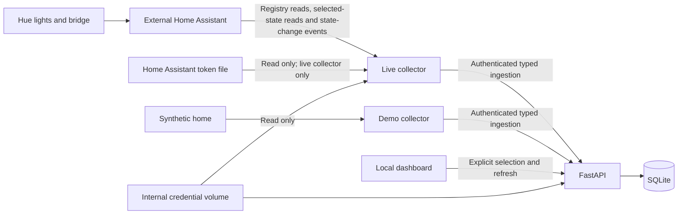

# Architecture

Choose one collector mode. FastAPI is the only SQLite writer. The collector has
no database mount. Discovery describes devices but grants no monitoring approval.
Selection and ingestion use SQLite transactions and a server-owned revision.
Delayed collection cannot bypass a removal or a new selection revision.

## Where the code lives

- `apps/observer/src/home_observer`: the FastAPI app (`api.py`), the demo
  collector (`demo.py`), the live collector and Home Assistant connector
  (`live.py`, `home_assistant.py`), and the SQLite store (`store.py`).
- `apps/web`: the dashboard. It is built in the Docker image's Node stage, and
  FastAPI serves the result from the same container. Its API types in
  `apps/web/src/api/schema.d.ts` are generated from the observer's OpenAPI schema
  with `mise run gen:api`, so the compiler catches a mismatch between API and UI.

The security rules around this layout are in [security.md](security.md).
