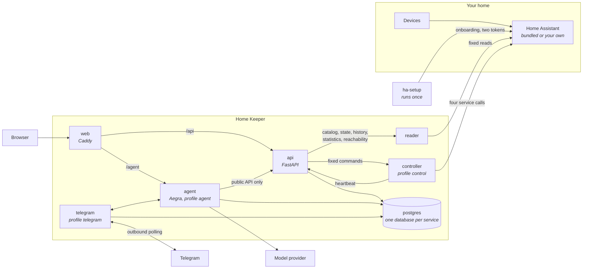
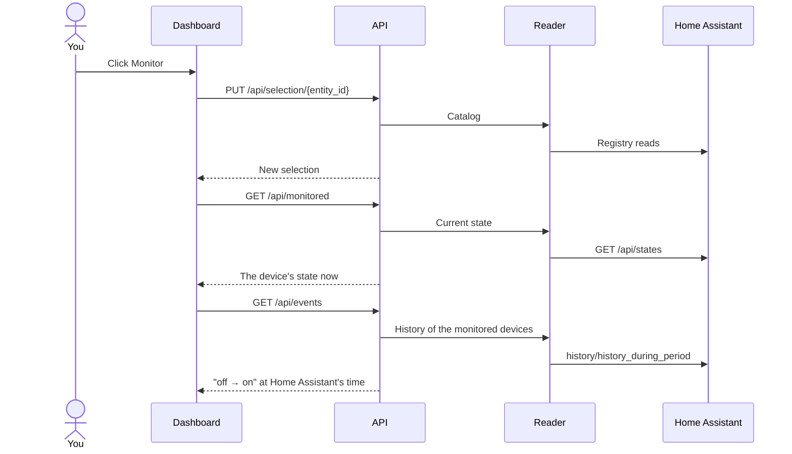

# Architecture

Home Keeper is a small set of containers around one rule: Home Assistant owns
devices and their history, and Home Keeper reads them on demand. Home Keeper
stores only what is its own: the monitored devices and the command log.

## Services

| Service      | Code                                         | Role                                                                                          |
| ------------ | -------------------------------------------- | --------------------------------------------------------------------------------------------- |
| `web`        | `apps/web`                                   | Serves the dashboard on the only published Home Keeper port. Forwards `/api` and `/agent`.    |
| `api`        | `apps/keeper`                                | Validates requests, answers them from the reader and the store, and sends commands.          |
| `reader`     | `apps/keeper` (`reader_service.py`, `home_assistant.py`) | Holds the Home Assistant token. Answers fixed reads. Keeps no state. In the demo, serves the synthetic home (`demo.py`). |
| `controller` | `apps/controller`                            | Optional. Holds the control token. Sends four fixed service calls. Publishes no port.        |
| `postgres`   | `compose.postgres.yaml`                      | One database per service.                                                                     |
| `db-setup`   | `compose.postgres.yaml`                      | Runs once. Creates each service's database, login and password.                               |
| `ha-setup`   | `apps/keeper` (`ha_setup.py`)                | Runs once. Onboards the bundled Home Assistant and stores both tokens.                        |
| `agent`      | `apps/agent`                                 | Optional. Answers questions with tools over the public API.                                   |
| `telegram`   | `apps/agent` (`telegram.py`)                 | Optional. Connects private Telegram chats to the agent. Publishes no port.                    |

### Inside the API

Python code lives in `apps/keeper/src/home_keeper`.

| Module                                      | Responsibility                                                                  |
| ------------------------------------------- | ------------------------------------------------------------------------------- |
| `api.py`, `models.py`                       | Routes and response models.                                                     |
| `reader.py`                                 | The API's client for the reader.                                                |
| `monitoring.py`                             | Owns the selection. Checks a new selection against the catalog. Answers current state. |
| `changes.py`, `usage.py`, `measurements.py` | Turn history rows into changes and usage, and statistics into measurement totals, with unknown time named. |
| `commands.py`                               | Check, forward and record commands. Confirm the outcome. Track the heartbeat.   |
| `control.py`                                | The API's client for the controller.                                            |
| `store.py`                                  | Postgres: the selection, the command log, metadata and command retention.       |

## Design rules

- **Home Keeper stores only what is its own.** Device state and history are read
  from Home Assistant on each request. The dashboard never shows a stale copy.
- **Nothing is monitored until you select it.** Monitoring is the only filter
  for History, usage and the agent.
- **The reader is read-only.** It makes fixed reads only: no service calls, no
  event subscriptions, no device writes, no database access. The keeper image
  contains no controller code.
- **Control is opt-in and narrow.** Only the controller calls Home Assistant
  services, and only four of them. It has no passthrough. Control is `on` only
  while its heartbeat is fresh.
- **Every command leaves evidence.** The API refuses a command for a device that
  is not monitored, has no known state, is unavailable or is already in the
  requested state. It records every command it forwards with the outcome it
  observed.
- **Unknown, not guessed.** Time without history, or with the device
  unavailable, is unknown. The API never invents a change.
- **The API is the only writer.** Only the API holds the keeper database's
  password. Internal endpoints of the reader and the controller require a
  service credential that the API creates at startup.
- **The API never reaches Home Assistant.** It does not join the
  `home-assistant` network.

[security.md](security.md) details each boundary.

## Request flow: monitoring a device

The dashboard polls every 3 seconds. Each poll reaches Home Assistant through
the reader.

## Storage

| Database   | Owner                       | Tables                                                                         |
| ---------- | --------------------------- | ------------------------------------------------------------------------------ |
| `keeper`   | `api` (`store.py`)          | `selection`: monitored devices and their kind. `metadata`: the source and the last heartbeat. `commands`: one JSONB record per command, ordered by `sent_at` and `id`. |
| `agent`    | `agent` (Aegra)             | Chat threads, runs and LangGraph checkpoints, in Aegra's schema.               |
| `telegram` | `telegram`                  | `progress`: the next update to read. `bot_owner`: the bot this state belongs to. `conversations`: each person's conversation. |

Each service has its own login and can open only its own database. Device
history is not stored here.

## API contract

- Every public `/api/*` route has a response model.
- The dashboard's types in `apps/web/src/api/schema.d.ts` are generated from
  the OpenAPI schema with `mise run gen:api`. A field rename the UI does not
  follow fails the TypeScript build.
- Snapshot tests in `test_api_contract.py` pin the response shapes.

## Terms

[CONTEXT.md](../CONTEXT.md) defines the domain terms the code uses: device,
device kind, selection, reading, label, command, outcome, refusal and evidence.
