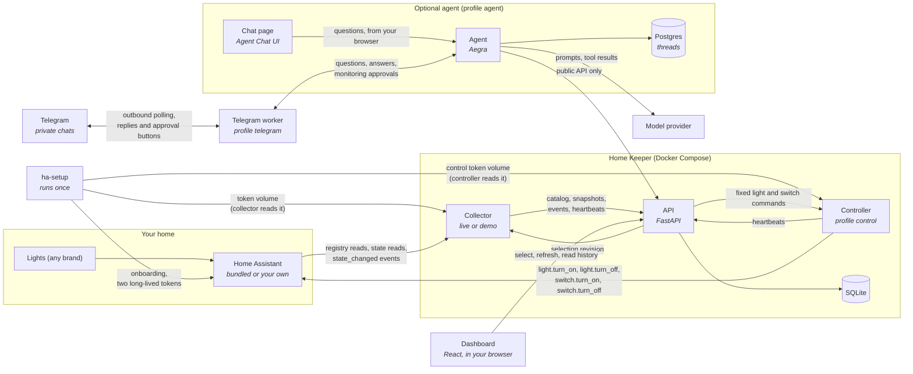
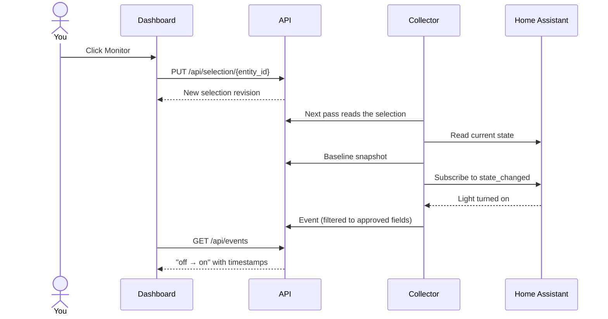

# Architecture

Home Keeper has three running parts: a collector that reads the home, an API
that decides what to keep, and a dashboard that shows it. They run as two
containers from one image. The default stack adds a bundled Home Assistant and
a one-shot `ha-setup` container that onboards it and stores the collector's and
the controller's tokens.
The optional `control` profile adds a controller, from its own image, that
switches monitored lights, plugs and switches for the API; [control.md](control.md) covers it.
The optional `agent` profile adds a chat agent, its chat page and a Postgres for
its threads; [agent.md](agent.md) covers it.
The separate `telegram` profile adds a polling worker that connects private
Telegram chats to the same agent; [telegram.md](telegram.md) covers setup.

| Part      | Code                                   | Job                                                                                         |
| --------- | -------------------------------------- | ------------------------------------------------------------------------------------------- |
| Collector | `live.py`, `home_assistant.py`         | Reads Home Assistant. Keeps only selected lights and approved fields. Sends typed records.   |
| Setup     | `ha_setup.py`                          | Onboards the bundled Home Assistant once and stores the collector's token. Creates the non-admin control user and its token. Checks both tokens on later runs. |
| Demo      | `demo.py`                              | Replaces the live collector with a synthetic home. Same API calls, no hardware. Applies demo light commands. |
| API       | `api.py`, `models.py`, `control.py`    | Validates every record, owns the selection, and records collection gaps. Checks, forwards and records light commands. |
| Controller | `apps/controller`                     | Optional (profile `control`). Sends the four fixed calls (`light.turn_on`, `light.turn_off`, `switch.turn_on`, `switch.turn_off`) for monitored lights, plugs and switches to Home Assistant with its own token, or to the demo collector. Publishes no port. |
| Recorder  | `recorder.py`                          | Admits baselines and events, stores them, and decides which one is a light's current state. |
| Store     | `store.py`                             | SQLite schema, transactions, retention.                                                     |
| Dashboard | `apps/web`                             | Discovery, selection, current state, the change timeline, and collection gaps.              |
| Agent     | `apps/agent`                           | Optional. Answers questions with tools over the public API. Never reads the database or Home Assistant. |
| Chat      | `apps/chat`                            | Optional. Builds the unmodified Agent Chat UI. Your browser talks to the agent directly.    |
| Telegram  | `apps/agent/src/home_keeper_agent/telegram.py` | Optional. Polls private messages from allowed users and forwards questions and approvals to the agent. Publishes no port. |

Python code lives in `apps/keeper/src/home_keeper`.

## Rules the layout enforces

- **The API is the only writer.** The collector has no database mount. It posts
  to internal endpoints that need a service credential the API creates at
  startup.
- **Nothing is monitored until you select it.** Discovery lists devices. It does
  not approve them. Each selection change bumps a server-owned revision. The API
  rejects data from a collector that works from an older revision, so a slow
  read cannot bring back a light you just removed.
- **The collector is read-only toward the home.** The connector makes fixed
  registry reads, one state read for each new light or switch candidate at
  discovery to detect groups, selected-state reads and one filtered event subscription. It
  has no service calls and no device writes. The collector image contains no
  controller code.
- **Control is opt-in and narrow.** Only the controller calls Home Assistant
  services, and only `light.turn_on` (with an optional brightness percent) and
  `light.turn_off` on `light.*` entities, and `switch.turn_on` and
  `switch.turn_off` on `switch.*` entities. It has no passthrough. It runs only
  with the `control` profile, and the API reports control `on` only while the
  controller's heartbeat is fresh.
- **Every command leaves evidence.** The API refuses a command for a light that
  is not monitored, has no known state, is unavailable or is already in that
  state. It records every command it forwards, with the outcome it observed.
- **Evidence, not guesses.** When collection stops, the API records a gap. After
  recovery it stores a fresh snapshot and marks the transition time as unknown.
  It never invents the change that happened while it was blind.

## Selecting a light

A collection pass runs every 10 seconds by default. Between passes, live mode
streams events as Home Assistant sends them.

## Words used in the code

| Term        | Meaning                                                                                       |
| ----------- | --------------------------------------------------------------------------------------------- |
| Source      | Where data comes from: `demo` or `home_assistant`. One database holds one source.             |
| Catalog     | The devices and entities the collector discovered, with whether each one can be monitored.   |
| Device kind | What a recorded entity is, from its Home Assistant domain: `light` or `switch` (plugs too). Every stored row carries it; a one-time migration, with a backup, added it to older databases. Separate from a record's `kind` (baseline, event, ...). |
| Selection   | The lights, plugs and switches you chose to monitor, plus a revision number the API owns.    |
| Baseline    | A snapshot of a device's state. Taken at selection, during polling, and after recovery.      |
| Event       | One observed change, with old and new values and three timestamps (fired, received, saved).  |
| Recorder    | Admits a baseline or event, stores it once, and decides whether it becomes the device's current state. |
| Gap         | A period when collection was interrupted. Open until a recovery snapshot closes it.          |
| Freshness   | How recently Home Assistant answered. It says nothing about whether the bulb itself answered. |
| Command     | A request to switch a monitored light, plug or switch, with its sender and the outcome the API observed. |

## The API contract

The dashboard's types in `apps/web/src/api/schema.d.ts` are generated from the
API's OpenAPI schema with `mise run gen:api`. A field rename that the UI does not
follow fails the TypeScript build. Snapshot tests in `test_api_contract.py` pin
the response shapes.

[collection.md](collection.md) covers collection, gaps and retention in detail.
[security.md](security.md) covers the trust boundaries.
